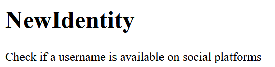

> Version 0.1 BETA


**Live demo:** [newidentity.webcris.icu](https://newidentity.webcris.icu)

---

[How it works](#how-it-works) | [Limitations](#limitations) | [Self-hosting](#selfhosting) | [License](#license)

---

## How it works
 
The frontend sends a request like `/get/github/crislazy` to the backend. The backend:
 
1. Checks the site name against its own table of known sites.
2. Validates the username (letters, numbers, `_`, `.` and `-`, up to 39 characters).
3. Asks the site's public endpoint for that user, with a 6 second timeout and redirects disabled.
4. Turns the HTTP status code into a result: the site's "exists" code means `taken`, its "missing" code means `available`, and anything else (rate limits, errors, timeouts) means `unknown`.


## Supported sites

>Note: This shows the supported sites by the api, not website

- Github
- Gitlab
- Codeberg
- Git.gay
- Tiktok
- Bluesky
- HuggingFace

## Limitations

- "Available" means no profile was found. The name may still be reserved or blocked by the site.
- Results can be `unknown` when a site rate-limits, times out or returns something unexpected.
- Instagram, Discord and some other platforms aren't supported because they have no reliable public check. (not to my current knowledge)

## Selfhosting

### Configuration

Before running your own instance, make these changes:

**1. Frontend API URL**

Open your frontend JavaScript file and change:

```js
const API_URL = "https://api-newidentity.webcris.icu";
```

to your own backend URL, for example:

```js
const API_URL = "http://127.0.0.1:5000";
```

**2. Backend CORS configuration**

Open `backend/main.py` and find the CORS configuration:

```python
CORS(app, resources={
    r"/*": {
        "origins": [
            "https://newidentity.webcris.icu"
        ]
    }
})
```

Replace `https://newidentity.webcris.icu` with your own frontend URL.

For local development, you might use:

```python
"origins": [
    "http://localhost:8080"
]
```

If you host the frontend on multiple domains, you can add them to the list.

**Important:** Make sure the frontend URL in the CORS configuration matches the actual origin (including the protocol and port) used to access your frontend.

### Run it locally
 
You need Python 3.12 or newer.
 
```bash
git clone https://github.com/crislazy/newidentity
cd newidentity
pip install -r requirements.txt
python backend/main.py
```
 
The API is then available at `http://127.0.0.1:5000`. Try `http://127.0.0.1:5000/get/github/crislazy`.
 
### Run it with Docker
 
Backend (from the repository root):
 
```bash
docker build -t newidentity-backend .
docker run -p 5000:5000 newidentity-backend
```
 
Frontend (static files served by nginx):
 
```bash
docker build -t newidentity-frontend ./frontend
docker run -p 8080:80 newidentity-frontend
```
 
The backend image runs the app with gunicorn.

### Adding a site
 
Open `backend/main.py` and add one line to the `SITES` dictionary:
 
```python
"name": ("https://example.com/api/users/{u}", 200, 404),
```

`https://example.com/api/users/{u}` is the api url, with `{u}` being the username that will be replaced by the code(don't modify it)

`200` is the "taken" status code, change it if a website uses a different status code

`404` is the "available" status code, change it if a website uses a different status code


## Built With

- Python
- Vanilla HTML, CSS and JavaScript

## License

[MIT](LICENSE)
